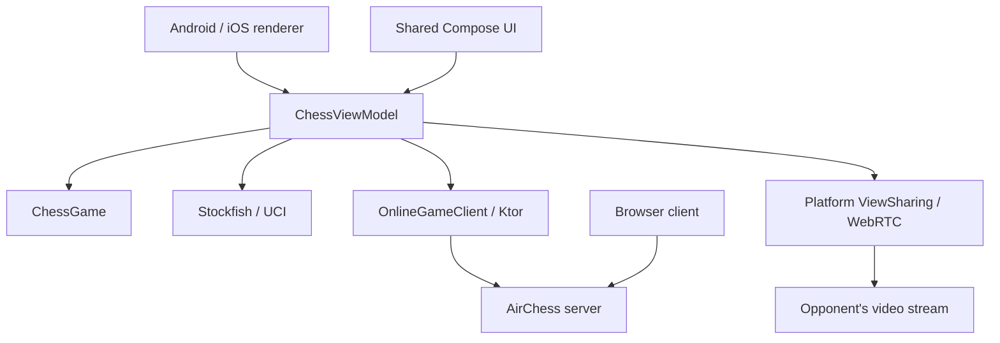

# AirChess development

Building, running, and deploying AirChess. For the product overview, see [README.md](README.md).

## Pointing the app at a server

Release APKs from GitHub have the hosted server built in (the `AIRCHESS_SERVER_URL` secret). Local builds default to `ws://localhost:8080/ws`, which reaches a server on your computer after `adb reverse tcp:8080 tcp:8080`. To bake in a hosted server locally, set `airchess.serverUrl=wss://your.host/ws` in `local.properties` (gitignored) or pass `-Pairchess.serverUrl=...`. Players can also change the URL in Settings or the Play online sheet; a saved URL overrides the built-in default.

## Feature reference

- First-run onboarding that asks for your name; a home screen with Resume game, Play on the table, Play the computer, and Play a friend online.
- Tabletop AR chess: ARCore plane detection places a board on a real table and anchors it there.
- Complete chess rules: castling, en passant, promotion, check, checkmate, stalemate, fifty-move rule, threefold repetition, insufficient material.
- Tap a piece to select it. Legal moves show as dots, captures as rings. Tap a destination to move.
- Animated moves, last-move and check highlights, and promotion to any piece.
- Haptic feedback for moves, check, and game end.
- Undo and reset (local games).
- Move history in SAN.
- Stockfish 19 hints drawn as an arrow on the board, with an evaluation. Disabled during live online games and available again once the game ends.
- Threatened-squares view.
- Play the computer: Easy, Medium, Hard, Max. Undo takes back a full round. If Stockfish fails, continue the same position as a local game.
- Resume: local and computer games survive leaving the game; online games resume by code and token.
- Web client at `/play/`: 2D and 3D boards, local and computer play (Stockfish WASM), online play against the app. Hint depth, board flip, threat view, drag-and-drop moves, invite copy/share, an **Open in AirChess app** link on Android, resume of an interrupted online game, and a **Download Android app** link.
- Online multiplayer:
  - Private games joined by 6-character codes or invite links (`airchess://join/CODE` in the app, `https://<host>/play/?code=CODE` in a browser). Opening an invite during another game asks before leaving it.
  - Pick your color: White, Black, or Random.
  - Server-authoritative clocks: 1+0, 3+2, 5+0, 10+0, 15+10.
  - Resign, draw offers, and rematch with color swap. Leaving a live game asks first, because it forfeits.
  - Reconnect within 60 seconds; Resume game rejoins after the app restarts.
  - Share view: streams the rendered board view (AR camera plus pieces, or the 3D/2D board) over WebRTC. No microphone, no other apps, no UI overlays. Tap the corner preview to see the opponent's view full screen; tap your own preview to return.
  - Privacy: sharing is off until you tap **Share view**, and either player can stop it. Video goes directly to your opponent and is not recorded. When a direct connection is not possible it passes, encrypted, through the Xirsys TURN relay. The AirChess server only forwards connection setup messages.
- 3D fallback for devices without ARCore, or by choice with **Prefer 3D board**.
- Debug overlay: tracking state, plane count, FPS, anchor, FEN.

## Tech stack

- Kotlin 2.4, Jetpack Compose, Material 3
- ARCore, SceneView 4.62 (ARSceneView), Filament (via SceneView), glTF/GLB models
- Kotlin coroutines and StateFlow
- Stockfish 19 over UCI
- Ktor 3 WebSockets (client and server)
- kotlinx.serialization
- WebRTC (`io.github.webrtc-sdk:android`) for view sharing, with a Xirsys TURN relay fallback
- Web client: chess.js, three.js, stockfish.js (WASM), browser WebRTC

## Architecture



`ChessGame` owns the position. Renderers consume `BoardViewState` and report taps, never legal moves. `PieceReconciler` keeps piece identities across positions. The server checks moves with the same `:chess` rules. Android uses SceneView/Filament. iOS uses RealityKit and ARKit. Each platform captures only its board view for WebRTC.

| Module | Contents |
|---|---|
| `:chess` | Multiplatform (JVM, iOS) rules, FEN, SAN |
| `:protocol` | Multiplatform (JVM, iOS) wire messages |
| `:shared` | Android/iOS Compose UI, view model, UCI driver, online client, models, board math, and preferences. Exports the static `Shared` framework on iOS |
| `:server` | Ktor server |
| `:app` | Android rendering, Stockfish process, WebRTC, and platform services |
| `server/src/main/resources/web/` | Browser client served at `/play/` |
| `iosApp/` | SwiftUI host, RealityKit/ARKit renderer, USDZ assets, and XcodeGen project |
| `ios/stockfish/` | Pinned Stockfish sources, C bridge, and XCFramework build |

## Requirements

- Android Studio Otter or newer (AGP 9.4).
- JDK 17+ for Gradle. Android Studio's bundled JBR works.
- Android SDK 37 platform installed.
- ARCore-supported phone running Android 8.0 (API 26)+ with Google Play Services for AR. arm64 is required for Stockfish hints.
- Network access on first build: Gradle downloads the pinned Stockfish 19 release (~80 MB) into `.cache/stockfish/` and verifies its SHA-256.

## Build and install

```sh
sh ./gradlew assembleDebug            # app/build/outputs/apk/debug/app-debug.apk
adb install -r app/build/outputs/apk/debug/app-debug.apk
sh ./gradlew :chess:jvmTest :protocol:jvmTest :shared:testAndroidHostTest :app:testDebugUnitTest :server:test
```

On Windows use `gradlew.bat`. Release: `sh ./gradlew assembleRelease`. Local releases use the demo debug key unless `AIRCHESS_KEYSTORE_FILE` and the matching signing environment variables are set.

## Android downloads

[Download the latest APK](https://github.com/Monster0506/airchess/releases/latest/download/airchess.apk), or use **Download Android app** on the website. No GitHub login is required. Android may ask you to allow installation from your browser.

`.github/workflows/android-release.yml` tests and builds every push to `main`, including merged pull requests. It publishes a signed APK and `SHA256SUMS` as a public GitHub Release only after all checks pass. Failed builds leave the previous download available. Older builds remain in [Releases](https://github.com/Monster0506/airchess/releases).

The workflow uses standard Linux runners on this public repository, with no Actions artifact storage or paid services. It skips private repositories. The workflow can also be started manually on `main`.

Repository secrets:

| Secret | Value |
|---|---|
| `AIRCHESS_SERVER_URL` | Hosted `wss://` chess server URL |
| `ANDROID_KEYSTORE_BASE64` | Base64-encoded signing keystore |
| `ANDROID_KEYSTORE_PASSWORD` | Keystore password |
| `ANDROID_KEY_ALIAS` | Signing key alias |
| `ANDROID_KEY_PASSWORD` | Signing key password |

Keep the signing key unchanged so installed apps can update. CI uses the existing demo signing certificate. Keep a backup of that keystore outside Git; losing it prevents compatible updates. CI increments the version code with each workflow run and never commits the server URL or signing key.

## Multiplayer server

```sh
sh ./gradlew :server:run              # listens on 0.0.0.0:8080, prints ws:// LAN URLs
```

Point the app at it: Online -> Server URL (e.g. `ws://192.168.1.20:8080/ws`), or bake a default via `airchess.serverUrl=ws://...` in `local.properties`. For a USB-connected phone, run `adb reverse tcp:8080 tcp:8080` and use `ws://localhost:8080/ws` (the default). Deployment details: see [server/README.md](server/README.md).

View sharing connects peers directly over STUN. For peers that cannot connect directly, set `XIRSYS_IDENT`, `XIRSYS_SECRET` and `XIRSYS_CHANNEL` on the server to hand out short-lived TURN credentials. The free Xirsys Developer plan is hard-capped: relay stops at the monthly allowance instead of billing.

## Controls

- **Placement:** move the phone slowly over a table until the outline appears, then tap to place. Reposition returns to placement.
- **Play:** tap a piece to select it (only the side to move, or your color online). Dots mark legal moves and rings mark captures. Tap a destination to move. Promotion opens a picker.
- **Buttons:**
  - Undo (in computer games, takes back your move and the reply)
  - Reset (local only)
  - Resign / Draw (online)
  - Reposition
  - Hint
  - History
  - Share view / Stop sharing (online)
  - Settings: name, server URL, Prefer 3D board, engine depth 8-20, legal-move dots, threatened squares, haptics, debug overlay
  - Online: create or join with a code. Share invite and Copy invite link send a link that opens the game.
- **Game over:** Play again or Home in local and computer games; Rematch or Home online.

## Testing

- `:chess`: rules, including perft.
- `:protocol`: codec.
- `:shared`: view model (local, computer, online, resume, expired rooms, view sharing), UCI parsing and engine driver, board geometry, piece reconciliation.
- `:server`: rooms, clocks, view-sharing signaling, WebSocket integration.
- `:app`: Android-only code (SceneView math adapters, UI formatting).

```sh
sh ./gradlew :chess:jvmTest :protocol:jvmTest :shared:testAndroidHostTest :app:testDebugUnitTest :server:test
```

The iOS targets cannot build on Windows or Linux. The `iOS shared` workflow runs `:chess:iosSimulatorArm64Test`, `:protocol:iosSimulatorArm64Test`, `:shared:iosSimulatorArm64Test` and links the `Shared` framework on macOS.

## iOS builds

Requirements: macOS, Xcode 26.2, JDK 21, Android SDK 37, and XcodeGen (`brew install xcodegen`).
The app targets iOS 18+. AR requires an ARKit-compatible iPhone or iPad. The Simulator uses the 3D board.
AR placement still requires a real-device test.

```sh
bash ios/stockfish/build.sh ios
cd iosApp
xcodegen generate
open AirChess.xcodeproj
```

Select the AirChess scheme and an iPhone Simulator in Xcode. The build phase compiles the shared Kotlin framework.
For a device, set your registered bundle ID and Apple team in `iosApp/Config/Signing.xcconfig`.
Command-line builds can override `AIRCHESS_BUNDLE_ID` and `DEVELOPMENT_TEAM`.
The default server is `wss://krakenper-gambit.exe.xyz/ws`. Settings can override it.

The `iOS app` workflow builds and runs the Simulator app on macOS.
The `iOS shared` workflow runs native rules, state, and real Stockfish tests.
Unsigned Simulator apps cannot install on an iPhone.

### TestFlight

Create an App Store Connect app record with the same bundle ID.
Create the GitHub environment `ios-release`, then add these variables:

| Variable | Value |
|---|---|
| `AIRCHESS_BUNDLE_ID` | Registered iOS bundle ID |
| `APPLE_TEAM_ID` | Apple Developer team ID |

Add these secrets to that environment:

| Secret | Value |
|---|---|
| `IOS_CERTIFICATE_BASE64` | Base64 Apple Distribution certificate and private key, exported as `.p12` |
| `IOS_CERTIFICATE_PASSWORD` | Password for the `.p12` |
| `IOS_PROFILE_BASE64` | Base64 App Store provisioning profile for this team and bundle ID |
| `APP_STORE_KEY_ID` | App Store Connect API key ID |
| `APP_STORE_ISSUER_ID` | API issuer ID |
| `APP_STORE_PRIVATE_KEY_BASE64` | Base64 API private key (`.p8`), with app upload permission |

The existing repository secret `AIRCHESS_SERVER_URL` supplies the server URL.
Keep keys outside Git and chat.

Run **iOS release** from GitHub Actions. Select `unsigned` for a device archive without signing or upload.
Select `testflight` for a signed archive, IPA export, validation, and upload through Apple's `altool`.
Each workflow run uses a new build number. After Apple processes the upload, assign testers in App Store Connect.
An unsigned archive is not installable. A successful upload does not mean Apple approved external testing.
Signed export and upload require Apple credentials and have not run yet.

`airchess://join/CODE` opens the native invite flow. HTTPS invites open the browser, which provides an explicit **Open in AirChess app** button.
Universal links require a registered team and associated-domain setup. They are not configured.


## Assets and licenses

See [ATTRIBUTIONS.md](ATTRIBUTIONS.md) for full details.

- Board and piece GLB/USDZ assets come from `tools/models/generate_models.py` (CC0).
- AirChess is GPLv3. Stockfish 19 uses a separate process on Android and static linking on iOS.
- SceneView and SceneViewSwift are Apache 2.0.
- WebRTC is BSD-3-Clause with an additional patent grant.
- Web client: chess.js (BSD-2-Clause), three.js (MIT), stockfish.js (GPLv3).
- The ARCore SDK is provided under Google's terms.
